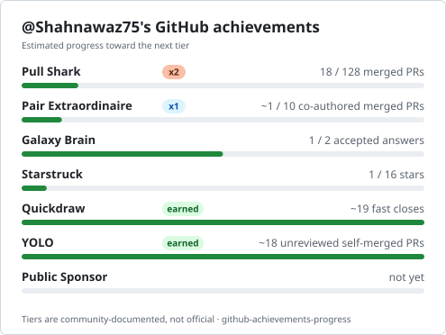

# GitHub Achievements Progress: see how close you are to every GitHub badge

See your **GitHub achievements** progress in one place (how many merged pull requests you need for the next tier of **Pull Shark**, why **Pair Extraordinaire** or **Galaxy Brain** didn't unlock, how close you are to **Starstruck**, and whether **Quickdraw** and **YOLO** are probably already yours), then show it off with a **profile README card**.

<picture>
  <source media="(prefers-color-scheme: dark)" srcset="docs/example-card-dark.svg">
  
</picture>

[](https://github.com/Shahnawaz75/github-achievements-progress/actions/workflows/ci.yml)
[](LICENSE)

`gh-achievements` is a small command-line tool and GitHub Action written in Python, with no dependencies. It reads your GitHub data, works out which tier you most likely have for every achievement, tells you how many more you need for the next one, and explains in plain words why a badge did or didn't unlock.

## Why?

GitHub shows your badges, but not your progress. There's no counter for "how many merged PRs until Pull Shark x3?" and no explanation when a badge doesn't appear. Community threads are full of the same questions:

- *"My Pair Extraordinaire didn't unlock."* Usually the person was the **PR author**. GitHub credits the people named in the `Co-authored-by:` trailer, not the author, and only if the trailer's email is **linked to their account**.
- *"I have 16 PRs, where is my x2?"* Only **merged** PRs count, and new badges can take **hours to a few days** to show up.
- *"I have 300 stars, why no Starstruck x2?"* It's stars on **one** repository, not your total.

This tool answers those questions with your real data.

> **This is not a badge-farming tool.** It only reads data and explains it. It never creates pull requests, issues, commits, stars, sponsorships or any other activity, and it never writes to GitHub.

## Install

```bash
pip install git+https://github.com/Shahnawaz75/github-achievements-progress
```

You need Python 3.9 or newer. There are no third-party dependencies. A PyPI release is coming soon.

## Quick start

```bash
# Optional but recommended: a token gives complete results (read-only use)
export GITHUB_TOKEN=$(gh auth token)          # PowerShell: $env:GITHUB_TOKEN = (gh auth token)

gh-achievements progress <your-username>                       # progress toward every achievement
gh-achievements why <your-username> pair-extraordinaire        # why didn't it unlock?
gh-achievements card <your-username> -o achievements.svg       # SVG card for your profile README
```

`python -m github_achievements_progress ...` works too. Without a token the tool still runs on public data, but Galaxy Brain, YOLO and Public Sponsor need GitHub's GraphQL API, which requires a token. The tool says so in its output.

## Check your progress

Real output for [@Shahnawaz75](https://github.com/Shahnawaz75) (more in [docs/example-output.md](docs/example-output.md)):

```text
$ gh-achievements progress Shahnawaz75
GitHub achievements progress for @Shahnawaz75 (estimated)

  Pull Shark           x2   [██░░░░░░░░░░░░░░] 18/128 merged PRs (110 more for x3)
  Pair Extraordinaire  x1~  [██░░░░░░░░░░░░░░] 1/10 co-authored merged PRs (9 more for x2)
                            commits naming you as co-author: 1 checked
  Galaxy Brain         -    [████████░░░░░░░░] 1/2 accepted answers (1 more for x1)
  Starstruck           -    [█░░░░░░░░░░░░░░░] 1/16 stars (15 more for x1)
                            most-starred repo: (private repository)
  Quickdraw            yes~ [████████████████] 19 fast closes (likely earned)
                            your most recent closed issues and PRs scanned: 19
  YOLO                 yes~ [████████████████] 18 unreviewed self-merged PRs (likely earned)
                            your most recent merged PRs checked: 18
  Public Sponsor       -    [░░░░░░░░░░░░░░░░] 0 sponsorships (none found)

~ approximate: based on a scan of recent activity, so the real number can be higher.
Tiers are community-documented, not official. GitHub can take a few hours to a few days to show a new badge or tier.
No longer earnable: Arctic Code Vault Contributor, Mars 2020 Contributor.
API budget left: core 4,949/5,000, graphql 4,985/5,000, search 26/30.
Why didn't a badge unlock? Run: gh-achievements why Shahnawaz75 <achievement>
```

- `x1` to `x4` is the tier the tool **estimates** you have (GitHub shows no label for the first tier, then x2, x3 and x4).
- `~` marks counts found by scanning recent activity. Treat them as a minimum.
- Add `--json` for scripting. Names of private repositories are hidden unless you pass `--show-private`.

## Why didn't my achievement unlock?

`gh-achievements why <username> <achievement>` explains the rules and shows the evidence it found. Achievement names are forgiving: `pair`, `Pair Extraordinaire` and `pair-extraordinaire` all work. Shortened real output (the full version is in [docs/example-output.md](docs/example-output.md)):

```text
$ gh-achievements why Shahnawaz75 pair-extraordinaire
Pair Extraordinaire for @Shahnawaz75
Status: 1 co-authored merged PR (approximate) -> tier x1 (estimated); x2 needs 10, 9 more to go.

How it works:
  - GitHub credits the people named in Co-authored-by: trailers on commits in a merged PR. The PR author does not earn it from their own PR.
  - The trailer email must belong to the co-author's GitHub account. Your noreply address always works: 153459617+Shahnawaz75@users.noreply.github.com
  ...
What we found:
  - Your newest co-authored PR was merged on 2026-11-24: give GitHub a few days to show it.

Commits that name you as co-author:
  - Add pair note 1 (27f1595) [another account's public repo, name redacted, 2026-11-24] in merged PR #1
      Co-authored-by: Shahnawaz75 <153459617+Shahnawaz75@users.noreply.github.com> -> linked to @Shahnawaz75: counts for you
```

For every `Co-authored-by:` trailer it shows whether GitHub links the email to an account. When it doesn't, you'll see *"this email is not linked to any GitHub account, so GitHub cannot credit it"*, the most common reason Pair Extraordinaire never appears. It also lists commits **you** authored with co-authors, to make clear that those credit them and not you.

The other diagnoses: `pull-shark` (merged vs. closed vs. open PRs), `galaxy-brain` (your accepted answers and why GitHub Community answers don't count), `starstruck` (your top repositories: it's one repo, not the total), `quickdraw` and `yolo` (the candidate issues and PRs found) and `public-sponsor`.

## Add a progress card to your GitHub profile README

1. Generate the card (or let the [GitHub Action](#github-action) do it every day):

   ```bash
   gh-achievements card <your-username> -o achievements.svg --dark-output achievements-dark.svg
   ```

2. Commit both files to your profile repository (the repository named exactly like your username).
3. Add this to its `README.md`. GitHub picks the right card for light and dark mode:

   ```html
   <picture>
     <source media="(prefers-color-scheme: dark)" srcset="achievements-dark.svg">
     
   </picture>
   ```

The card is a single SVG file with no external fonts, images or scripts, so it renders on GitHub as-is. It shows only counts and tiers, never repository names.

## GitHub Action

Keep the card up to date automatically. Create `.github/workflows/achievements.yml` in your profile repository:

```yaml
name: Update achievements card

on:
  schedule:
    - cron: "17 4 * * *"   # every day at 04:17 UTC
  workflow_dispatch:        # lets you run it by hand from the Actions tab

permissions:
  contents: write           # needed to commit the card

jobs:
  card:
    runs-on: ubuntu-latest
    steps:
      - uses: actions/checkout@v7
      - uses: Shahnawaz75/github-achievements-progress@main   # pin a release tag or commit SHA once available
        with:
          output: achievements.svg
          dark-output: achievements-dark.svg
          # token: ${{ secrets.ACHIEVEMENTS_TOKEN }}   # optional personal access token, see below
```

By default the action reads data with the workflow's built-in `GITHUB_TOKEN`, which only sees **public** activity. If you also contribute to private repositories, a read-only personal access token stored as a secret lets the tool count those too, which brings the numbers closer to what GitHub uses for your badges. Full details, all inputs and troubleshooting: [docs/github-action.md](docs/github-action.md).

## All GitHub achievements and tiers

| Achievement | How to earn it | Default | x2 (Bronze) | x3 (Silver) | x4 (Gold) |
|---|---|---|---|---|---|
| Pull Shark | Pull requests you opened that were merged | 2 | 16 | 128 | 1024 |
| Pair Extraordinaire | Co-authored commits in merged pull requests | 1 | 10 | 24 | 48 |
| Galaxy Brain | Answers accepted in Q&A discussions | 2 | 8 | 16 | 32 |
| Starstruck | Stars on one repository you own | 16 | 128 | 512 | 4096 |
| Quickdraw | Close an issue or PR within 5 minutes of opening it | 1 | - | - | - |
| YOLO | Merge your own PR without a review | 1 | - | - | - |
| Public Sponsor | Sponsor someone through GitHub Sponsors | 1 | - | - | - |
| Arctic Code Vault Contributor | 2020 GitHub Archive Program | no longer earnable | | | |
| Mars 2020 Contributor | Mars 2020 Helicopter Mission | no longer earnable | | | |

These thresholds are **community-documented, not official**: GitHub does not publish them. They live in a single file, [`tiers.py`](src/github_achievements_progress/tiers.py). The full guide, with the common reasons each one doesn't unlock, is in **[docs/achievements.md](docs/achievements.md)**.

## How it works

Every call is a read-only `GET` or GraphQL query.

| Achievement | What the tool reads | Accuracy |
|---|---|---|
| Pull Shark | GraphQL `user.pullRequests(states: MERGED) { totalCount }` (search API without a token) | exact for what the token can see |
| Pair Extraordinaire | Commit search for your noreply address, public email and username in `Co-authored-by:` trailers, then `GET /repos/{owner}/{repo}/commits/{sha}/pulls` for merged PRs. Trailer emails are checked with GraphQL `Commit.authors { user }`: `user: null` means not linked | approximate, up to 30 commits |
| Galaxy Brain | GraphQL `repositoryDiscussionComments(onlyAnswers: true)`, minus answers in `community/community` | exact for up to 100 answers |
| Starstruck | GraphQL repositories you own, ordered by stars (search API without a token) | exact for what the token can see |
| Quickdraw | Search `author:<you> is:closed`, newest 200, closed within 5 minutes of creation | approximate (recent items only) |
| YOLO | Your 50 newest merged PRs with `mergedBy` = you and no reviews | approximate (recent PRs only) |
| Public Sponsor | GraphQL `user.sponsoring { totalCount }` | sponsorships visible to the token |

The tool shows the remaining API budget, waits and retries when a limit resets within a minute, and otherwise stops with a clear message instead of a traceback. Exit codes: `0` ok, `1` GitHub or network error, `2` usage error, `3` rate limited. The token is read from `GITHUB_TOKEN` or `GH_TOKEN` and is never printed.

## Limitations

- **Estimates, not official data.** GitHub doesn't publish how it counts achievements, and the thresholds come from community research. GitHub can change the rules at any time.
- **What the token can see.** Without a token you get public data only, and Galaxy Brain, YOLO and Public Sponsor can't be checked. A token only sees the private repositories it has access to.
- **Scans are partial.** Quickdraw, YOLO and Pair Extraordinaire look at recent activity, so they are lower bounds. Pair Extraordinaire can miss trailers that use a private email address the tool doesn't know.
- **Delays.** GitHub can take hours to days to award a badge, and the search index can also lag behind.
- Organizations don't have achievements, and GitHub Enterprise Server isn't supported yet.

## FAQ

### How many pull requests do I need for Pull Shark x3?

128 merged pull requests (community-documented). The tiers are 2 for the first badge, 16 for x2, 128 for x3 and 1024 for x4. Only merged PRs count, not closed or open ones. Run `gh-achievements progress <you>` to see exactly how many more you need.

### Why didn't I get Pair Extraordinaire?

The most common reasons are:

1. You were the **PR author**. The badge goes to the people named in `Co-authored-by:` trailers, not the author.
2. The trailer's email is **not linked** to the co-author's GitHub account. Use their noreply address: `<id>+<username>@users.noreply.github.com`.
3. The pull request was **not merged**, or the trailer was dropped when the PR was squash-merged.
4. The trailer isn't in the **last lines** of the commit message after a blank line, or the format is off (`Co-authored-by: Name <email>`).
5. It's **too early**: badges can take a few days.

`gh-achievements why <you> pair-extraordinaire` checks all of these for you.

### How do I get Galaxy Brain?

Answer questions in a discussion category that supports answers (usually "Q&A") in a repository's Discussions. When the person who asked, or a maintainer, clicks **Mark as answer** on your reply, it counts. You need 2 accepted answers for the first tier, then 8, 16 and 32. Answers in GitHub's own Community discussions (`github.com/orgs/community`) don't count: GitHub [turned achievements off there](https://github.com/orgs/community/discussions/106536) in February 2024 because of spam.

### How long do GitHub achievements take to show up?

Often within a few hours, but community reports of one to several days are common. If `gh-achievements` says you qualified recently, give it a few days before assuming something is wrong.

### Do private contributions count?

GitHub doesn't document this. Here's one data point from our test account: its public merged-PR count (14) is below the Pull Shark x2 threshold (16), yet the profile shows x2, and with a token that can see private repositories the count is 18. That suggests private merged PRs do count. To include them, use a token that can read your private repositories.

### Can I hide achievements?

Yes. According to [GitHub Docs](https://docs.github.com/en/account-and-profile/setting-up-and-managing-your-github-profile/managing-contribution-settings-on-your-profile/showing-your-private-contributions-and-achievements-on-your-profile), go to **Settings** and, under **Profile settings**, deselect **Show Achievements on my profile**, then click **Update preferences**. To hide a single badge, open it from the Achievements section of your profile and click the eye icon (**Hide from profile**). Hidden badges stay visible to you.

## Contributing

Bug reports, ideas and pull requests are welcome. See [CONTRIBUTING.md](CONTRIBUTING.md), especially the section on **updating tiers when GitHub changes them**. Features that create activity to farm badges will not be accepted.

## License

[MIT](LICENSE) © 2026 Shahnawaz75

---

If this helped you understand your badges, a star helps other people find it.
