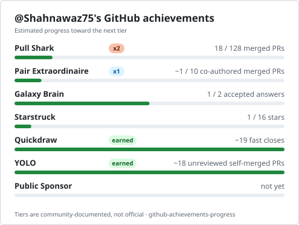
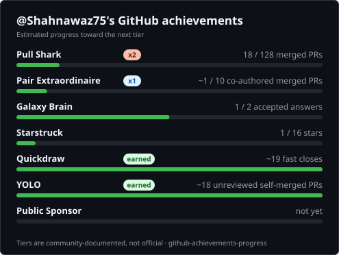

# Example output

Everything below is **real output**, captured on **2026-11-24** with `gh-achievements` 0.1.0 against the public account [@Shahnawaz75](https://github.com/Shahnawaz75). Only read-only API calls were made. With a token, names of private repositories are hidden unless you pass `--show-private`, which is why some lines say `(private repository)`.

**Sanity check against the profile.** That day the profile showed **Pull Shark x2**, **Quickdraw** and **YOLO**. The tool agrees: 18 merged PRs (x2), plus Quickdraw and YOLO candidates. It also reports 1 accepted answer (Galaxy Brain needs 2), 0 sponsorships, and a top repository with 1 star. Pair Extraordinaire is estimated at x1 from a co-authored PR merged **the same day**, so the badge wasn't on the profile yet. That's the normal delay, and `why` points it out.

## `progress` with a token

```text
$ export GITHUB_TOKEN=$(gh auth token)
$ gh-achievements progress Shahnawaz75
GitHub achievements progress for @Shahnawaz75 (estimated)

  Pull Shark           x2   [██░░░░░░░░░░░░░░] 18/128 merged PRs (110 more for x3)
  Pair Extraordinaire  x1~  [██░░░░░░░░░░░░░░] 1/10 co-authored merged PRs (9 more for x2)
                            commits naming you as co-author: 1 checked
  Galaxy Brain         -    [████████░░░░░░░░] 1/2 accepted answers (1 more for x1)
  Starstruck           -    [█░░░░░░░░░░░░░░░] 1/16 stars (15 more for x1)
                            most-starred repo: (private repository)
  Quickdraw            yes~ [████████████████] 19 fast closes (likely earned)
                            your most recent closed issues and PRs scanned: 19
  YOLO                 yes~ [████████████████] 18 unreviewed self-merged PRs (likely earned)
                            your most recent merged PRs checked: 18
  Public Sponsor       -    [░░░░░░░░░░░░░░░░] 0 sponsorships (none found)

~ approximate: based on a scan of recent activity, so the real number can be higher.
Tiers are community-documented, not official. GitHub can take a few hours to a few days to show a new badge or tier.
No longer earnable: Arctic Code Vault Contributor, Mars 2020 Contributor.
API budget left: core 4,949/5,000, graphql 4,985/5,000, search 26/30.
Why didn't a badge unlock? Run: gh-achievements why Shahnawaz75 <achievement>
```

## `progress` without a token

Without a token the tool only sees public data: 14 merged PRs instead of 18, which puts Pull Shark at x1. Galaxy Brain, YOLO and Public Sponsor need GitHub's GraphQL API, which requires a token.

```text
$ gh-achievements progress Shahnawaz75 --no-token
GitHub achievements progress for @Shahnawaz75 (estimated)

Note: No token: public data only and low rate limits. Galaxy Brain, YOLO and Public Sponsor need GITHUB_TOKEN (for example: export GITHUB_TOKEN=$(gh auth token)).

  Pull Shark           x1   [██████████████░░] 14/16 merged PRs (2 more for x2)
  Pair Extraordinaire  x1~  [██░░░░░░░░░░░░░░] 1/10 co-authored merged PRs (9 more for x2)
                            commits naming you as co-author: 1 checked
  Galaxy Brain         ?    needs a token (set GITHUB_TOKEN): GitHub's GraphQL API has no anonymous access
  Starstruck           -    [░░░░░░░░░░░░░░░░] 0/16 stars (16 more for x1)
                            most-starred repo: Shahnawaz75/lastest_attenddence
  Quickdraw            yes~ [████████████████] 14 fast closes (likely earned)
                            your most recent closed issues and PRs scanned: 14
  YOLO                 ?    needs a token (set GITHUB_TOKEN): GitHub's GraphQL API has no anonymous access
  Public Sponsor       ?    needs a token (set GITHUB_TOKEN): GitHub's GraphQL API has no anonymous access

~ approximate: based on a scan of recent activity, so the real number can be higher.
Tiers are community-documented, not official. GitHub can take a few hours to a few days to show a new badge or tier.
No longer earnable: Arctic Code Vault Contributor, Mars 2020 Contributor.
API budget left: core 56/60, search 8/10.
Why didn't a badge unlock? Run: gh-achievements why Shahnawaz75 <achievement>
```

## `why pair-extraordinaire`

```text
$ gh-achievements why Shahnawaz75 pair-extraordinaire
Pair Extraordinaire for @Shahnawaz75
Status: 1 co-authored merged PR (approximate) -> tier x1 (estimated); x2 needs 10, 9 more to go.

How it works:
  - GitHub credits the people named in Co-authored-by: trailers on commits in a merged PR. The PR author does not earn it from their own PR.
  - The trailer email must belong to the co-author's GitHub account. Your noreply address always works: 153459617+Shahnawaz75@users.noreply.github.com
  - Format: 'Co-authored-by: Name <email>' on its own line at the very end of the commit message, after a blank line. For squash merges, keep it in the final commit message.
  - Tiers (community-documented, not official): 1, 10, 24 and 48 co-authored merged PRs.

What we found:
  - commits naming you as co-author: 1 checked
  - Your newest co-authored PR was merged on 2026-11-24: give GitHub a few days to show it.

Commits that name you as co-author:
  - Add pair note 1 (27f1595) [bilalrao36402/pair-practice, 2026-11-24] in merged PR #1
      Co-authored-by: Shahnawaz75 <153459617+Shahnawaz75@users.noreply.github.com> -> linked to @Shahnawaz75: counts for you
      https://github.com/bilalrao36402/pair-practice/commit/27f1595f4f185bb09e30c3571c8b58b75b32685b

Recent commits you authored with co-authors (they get the credit, not you):
  - (hidden) [(private repository), 2026-11-24]
  - (hidden) [(private repository), 2026-11-24]
  - (hidden) [(private repository), 2026-11-23]
  - (hidden) [(private repository), 2026-11-23]
  - (hidden) [(private repository), 2026-11-23]

5 item(s) from private repositories are hidden; add --show-private to see them.

GitHub can take a few hours to a few days to show a new badge or tier.
```

## `why pull-shark`

```text
$ gh-achievements why Shahnawaz75 pull-shark
Pull Shark for @Shahnawaz75
Status: 18 merged PRs -> tier x2 (estimated); x3 needs 128, 110 more to go.

How it works:
  - Counts pull requests you opened that were merged. Closed-without-merge and open PRs don't count.
  - Tiers (community-documented, not official): 2, 16, 128 and 1024 merged PRs.

What we found:
  - 18 merged PRs: these count
  - 1 closed without merging: these don't count
  - 1 still open: they count once merged

GitHub can take a few hours to a few days to show a new badge or tier.
```

## `progress --json`

Trimmed to the first achievement; the real output lists all seven, each with its evidence `items`.

```json
{
  "user": "Shahnawaz75",
  "authenticated": true,
  "estimated": true,
  "thresholds_source": "community-documented, not official GitHub documentation",
  "achievements": [
    {
      "slug": "pull-shark",
      "name": "Pull Shark",
      "unit": "merged PRs",
      "count": 18,
      "approximate": false,
      "thresholds": [
        2,
        16,
        128,
        1024
      ],
      "tier": 2,
      "tier_label": "x2",
      "next_tier_label": "x3",
      "next_threshold": 128,
      "remaining": 110,
      "progress": 0.1406,
      "detail": "",
      "reason": "",
      "items": []
    }
  ],
  "no_longer_earnable": [
    "Arctic Code Vault Contributor",
    "Mars 2020 Contributor"
  ],
  "notes": [],
  "rate_limit": {
    "core": {
      "remaining": 4944,
      "limit": 5000,
      "reset": "2026-11-24T08:38:03Z"
    },
    "graphql": {
      "remaining": 4982,
      "limit": 5000,
      "reset": "2026-11-24T09:30:57Z"
    },
    "search": {
      "remaining": 22,
      "limit": 30,
      "reset": "2026-11-24T08:36:09Z"
    }
  }
}
```

## `card`

```text
$ gh-achievements card Shahnawaz75 -o docs/example-card.svg --dark-output docs/example-card-dark.svg
Wrote docs/example-card.svg (light theme) for @Shahnawaz75.
Wrote docs/example-card-dark.svg (dark theme) for @Shahnawaz75.
```

| Light | Dark |
|---|---|
|  |  |
