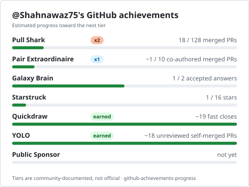

# GitHub Achievements Progress

**See how close you are to every GitHub badge, and why one didn't unlock.**

GitHub shows your achievements but not your progress. `gh-achievements` reads your GitHub data and tells you, for Pull Shark, Pair Extraordinaire, Galaxy Brain, Starstruck, Quickdraw, YOLO and Public Sponsor:

- the tier you most likely have now (x1 to x4),
- how many more you need for the **next tier**,
- in plain words, **why a badge didn't unlock** (for example, a `Co-authored-by:` email that isn't linked to any account),
- and a clean SVG **profile README card**, which a GitHub Action can update every day.



## Get started

```bash
pip install git+https://github.com/Shahnawaz75/github-achievements-progress
export GITHUB_TOKEN=$(gh auth token)      # optional, gives complete results
gh-achievements progress <your-username>
gh-achievements why <your-username> pair-extraordinaire
```

It's read-only and has no dependencies. It is **not** a badge-farming tool: it never creates pull requests, issues, commits or stars.

## Guides

- **[GitHub achievements guide](achievements.md):** every badge, the x2/x3/x4 thresholds, and the common reasons each one doesn't unlock.
- **[GitHub Action](github-action.md):** a self-updating progress card for your profile README.
- **[Example output](example-output.md):** real output of every command.

Source code, issues and the full README are on [GitHub](https://github.com/Shahnawaz75/github-achievements-progress).
